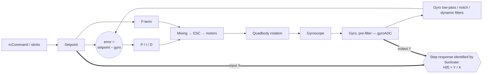
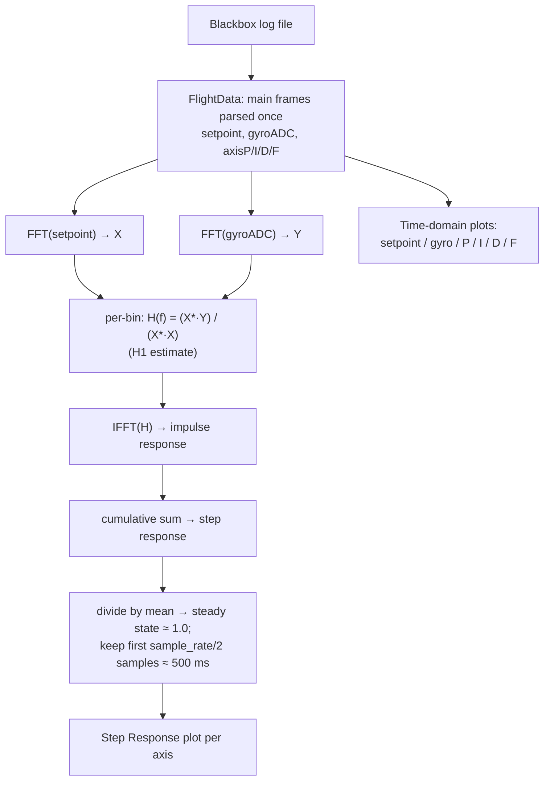

# Step Response & PID Analysis

**Languages:** English · [Русский](pid-analysis.ru.md)

Bucksaw's **Tune** tab is meant to help you evaluate and tune the rate-loop PID of a
Cleanflight-family quadcopter (Betaflight, INAV) directly from blackbox logs, without
any additional hardware. This document describes the principles behind that analysis:
first a practical guide, then the algorithm.

---

## 1. Practical guide

### 1.1 What the Tune tab shows

The Tune tab has two columns, each with one plot per axis (Roll, Pitch, Yaw):

- **Time Domain** (left) — time series taken straight from the log:
  - `Setpoint` — the desired rotation rate produced by the rate loop,
  - `Gyro` — rotation rate sampled at the log rate, *before* the gyro filters (`gyroADC`),
  - `Gyro (unfilt.)` — raw gyro at sensor rate (`gyroUnfilt`),
  - `P`, `I`, `D`, `F` — the individual PIDFF term contributions,
  - all available series are listed in `FlightData` (`src/flight_data.rs`: `setpoint()`,
    `gyro_filtered()`, `p()`, `i()`, `d()`, `f()`, …).
- **Step Response** (right) — the identified closed-loop step response per axis,
  computed by `calculate_step_response()` (`src/step_response.rs`) in a background
  thread (`TuneTab::calculate_responses()`).

> Which series exist depends on what your firmware logged (`debug_mode`). If
> `setpoint` or gyro data is missing, the corresponding plots stay empty.

### 1.2 Control loop and what bucksaw measures

Bucksaw does **not** attempt to recover the open-loop PID gains. It identifies the
closed-loop transfer function from `setpoint` to `gyro`, i.e. everything between
them: the PID controller, motor mixing, airframe dynamics and the sensor:



Consequences of this vantage point:

- the gyro filters are **not** inside the identified block (they sit in the feedback
  path), but their group delay still shapes the visible response;
- prop/motor lag and airframe inertia are part of the measurement;
- you see the loop exactly as the pilot experiences it — which is what you want
  when tuning.

### 1.3 How to read the step response

The response is normalized so the steady-state value is ≈ 1.0, and the plot window
covers roughly the first 500 ms after the step. Judge it by:

- **Rise time** — how fast the response leaves zero;
- **Overshoot** — peak above 1.0 (in %);
- **Ring count / settling time** — how many oscillations before it stays within
  ±5 % of 1.0;
- **Dead time** — flat delay before anything moves.

| Symptom | Likely cause | What to do |
|---|---|---|
| Large overshoot (> ~10 %) with several rings | P too high / D too low | Lower P, or raise D |
| Slow, sluggish rise, no overshoot | P too low | Raise P until slight overshoot appears |
| High-frequency, low-amplitude ripple after settling | D too high, noisy gyro, weak D-term filtering | Lower D, strengthen D-term filter; check the **Vibe** tab (FFT) |
| Noticeable dead time before the rise | Filter group delay, mechanical slop (props, frame) | Weaken gyro filters, tighten hardware |
| Response sags and never quite reaches 1.0 | I-term too low / I-term limits | Raise I, check I-term limits |
| Jagged, jittery trace overall | Noise, vibration, too short a log | Fix vibrations, analyze longer logs, compare several logs |

For **Yaw** the same reading applies, but expect a softer curve: yaw authority is
limited and the response is strongly influenced by the I-term and prop loading.

### 1.4 Time-domain analysis

The step response tells you *how the loop behaves*; the time-domain plots tell you
*why*:

- **Tracking error** — overlay `Setpoint` and `Gyro`: a good loop tracks the
  setpoint with a small, consistent lag. Systematic error on fast maneuvers is a
  P/D problem; random error is a noise/filter problem.
- **D-term on straight flight** — a “fizzy”, spiky D trace during calm flight means
  high-frequency noise is being amplified: increase D-term filtering or fix the
  vibrations (see the **Vibe** tab).
- **I-term during sustained disturbance** (wind, long straight pulls) — how well the
  I-term removes steady error; slow recovery means I is too low.
- **F-term at step edges** — the F-term spike at each stick flip should match the
  initial response demand. If P has to “push” through the start of every step,
  raise F; if the gyro leads the setpoint momentarily, F is too high.
- **Saturation** — any term or motor output flat-topped against its limit
  invalidates the linear model behind the step response: fix limits/props first,
  then tune.

### 1.5 Recommended tuning order

1. Set up gyro/D-term filtering first (check **Vibe** tab FFT; the step response of a
   noisy loop is meaningless).
2. Tune **P** up until slight overshoot appears, then back off slightly.
3. Tune **D** until the rings after the step damp out, without introducing
   high-frequency ripple.
4. Tune **I** for wind/hover correction without slow oscillation.
5. Tune **F** to match P at step edges.

Re-check the step response after every change, using sections with hard direction
reversals (stick flips) — they provide the best excitation.

---

## 2. Algorithmic description

### 2.1 Model and assumptions

`calculate_step_response()` treats the logged flight as an input/output experiment on
a linear time-invariant (LTI) system:

- input `X` = `setpoint` (°/s),
- output `Y` = gyro before filtering, `gyroADC` (°/s),
- estimate the frequency response `H(f) = Y/X`, convert it to a step response.

Assumptions and where they break:

- **Linearity & stationarity** — one estimate is produced for the whole log, so all
  maneuvers are averaged. Nonlinear elements (D-term setpoint weighting, dynamic
  notch filters, motor saturation) smear the result.
- **Exogenous input** — `setpoint` is generated from stick commands, but the pilot
  constantly corrects what they *see* the quad do, which correlates input and output
  and biases the estimate. Long logs with many random inputs reduce the bias.
- **Noise** — the estimator (H1, see below) is biased by output-side noise at low
  setpoint energy per frequency bin; this usually shows up as wobble in the step
  response tail.

### 2.2 Pipeline



The three axes are computed independently and asynchronously
(`TuneTab::calculate_responses()` hands the result to the UI through a
`BackgroundCompStore`).

### 2.3 The math, in code

In `calculate_step_response()` (`src/step_response.rs`):

1. **Forward FFTs.** Real-input FFTs (`realfft::RealFftPlanner`) of `setpoint` and
   `gyro_filtered` over the *entire* log, producing one-sided spectra `X` and `Y`.
2. **H1 frequency-response estimate**, per frequency bin:

   ```text
   H(f) = (X*(f) · Y(f)) / (X*(f) · X(f))
   ```

   This is the classic H1 estimator, `S_xy / S_xx`. The `X*` factor in the numerator
   makes the phase correct and weights bins by setpoint energy, so bins where the
   setpoint has little energy (where a naive `Y / X` would explode) are suppressed.
3. **Impulse response.** Inverse FFT of `H(f)`.
4. **Step response.** The cumulative sum of the impulse response — in discrete time,
   integrating a δ-excitation yields the response to a step.
5. **Normalization.** The response is divided by its mean over the whole window, so
   the steady-state level sits at ≈ 1.0.
6. **Window.** Only the first `sample_rate / 2` samples (≈ 0.5 s) are plotted; the
   x-axis is seconds since the first logged frame.

Supporting details:

- `FlightData::sample_rate()` estimates the loop rate as the median sample interval
  of the first 100 samples, rounded to the nearest 100 Hz.
- `FlightData::d()` returns optional per-axis series — `axisD[2]` (yaw) is often not
  logged; the time-domain plots handle this gracefully.

### 2.4 Limitations and gotchas

- **No windowing or segment averaging** — a single FFT of the whole log means
  spectral leakage across the whole record and one global average only. Short or
  quiet flights give noisy responses.
- **Normalization by the mean** — if the response hasn't actually settled inside the
  window, “1.0” is the mean level, not the asymptote; overshoot/sag are slightly
  distorted.
- **f32 arithmetic and one big FFT** — large logs eat memory and time, noticeable in
  the WASM build; keep FFT-unfriendly giant logs shorter when tuning.
- **Missing fields** — if `setpoint` or `gyroADC` isn't in the log
  (`debug_mode` dependent), the step response stays empty rather than guessing.
- The method measures the loop **around the filters**: filter changes show up in the
  response but cannot be separated from the PID contribution by this analysis alone.

---

## 3. Maintenance notes

- `docs/pid-analysis.md` (English) and `docs/pid-analysis.ru.md` (Russian) mirror
  each other 1:1 — same section numbering, same Mermaid diagrams (labels
  translated), same tables and code references. Always edit both files in the same
  commit.
- Reference **function names** (`calculate_step_response()`, `TuneTab::calculate_responses()`),
  never line numbers — line numbers rot.
- Technical terms (`setpoint`, overshoot, D-term, H1 estimator, …) are kept
  untranslated in both languages so they match firmware/CLI terminology.
