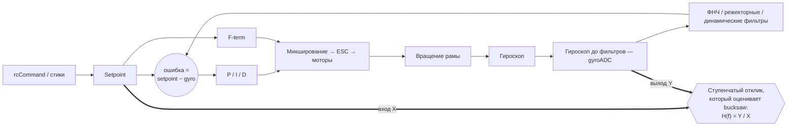
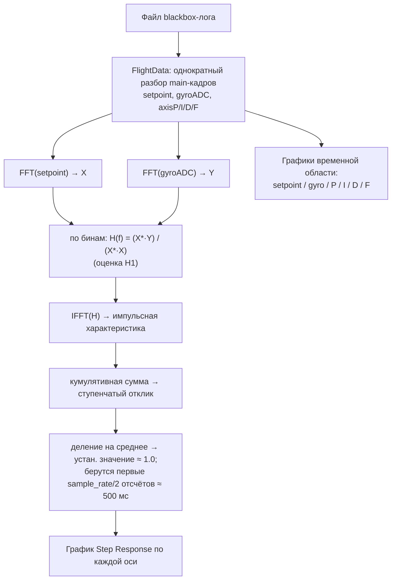

# Анализ PID и ступенчатого отклика

**Языки:** [English](pid-analysis.md) · Русский

Вкладка **Tune** в bucksaw предназначена для оценки и настройки PID-контура угловой
скорости (rate loop) квадрокоптеров семейства Cleanflight (Betaflight, INAV)
непосредственно по blackbox-логам, без дополнительного оборудования. Этот документ
описывает принципы такого анализа: сначала практическое руководство, затем алгоритм.

---

## 1. Практическое руководство

### 1.1 Что показывает вкладка Tune

Вкладка Tune состоит из двух колонок, каждая — с графиком по каждой оси
(Roll, Pitch, Yaw):

- **Time Domain** (слева) — временные ряды прямо из лога:
  - `Setpoint` — желаемая угловая скорость, задаваемая контуром;
  - `Gyro` — угловая скорость с частотой логирования, *до* фильтров гироскопа (`gyroADC`);
  - `Gyro (unfilt.)` — сырой гироскоп с частотой сенсора (`gyroUnfilt`);
  - `P`, `I`, `D`, `F` — вклады отдельных терминов PIDFF;
  - полный список доступных серий — в `FlightData` (`src/flight_data.rs`: `setpoint()`,
    `gyro_filtered()`, `p()`, `i()`, `d()`, `f()` и т. д.).
- **Step Response** (справа) — оценённый ступенчатый отклик замкнутого контура по
  каждой оси; считается функцией `calculate_step_response()`
  (`src/step_response.rs`) в фоновом потоке (`TuneTab::calculate_responses()`).

> Набор серий зависит от того, что писала прошивка в `debug_mode`. Если `setpoint`
> или данные гироскопа не логировались, соответствующие графики останутся пустыми.

### 1.2 Контур управления и то, что измеряет bucksaw

Bucksaw **не** пытается восстановить разомкнутые коэффициенты PID. Он оценивает
передаточную функцию замкнутого контура от `setpoint` до `gyro`, то есть всё, что
между ними: PID-регулятор, микширование, моторы, динамику рамы и сенсор:



Следствия такой точки наблюдения:

- фильтры гироскопа **не** входят в оцениваемый блок (они стоят в цепи обратной
  связи), но их групповая задержка всё равно формирует видимый отклик;
- задержка винтов/моторов и инерция рамы входят в измерение;
- контур виден ровно так, как его ощущает пилот, — именно это и нужно при настройке.

### 1.3 Как читать ступенчатый отклик

Отклик нормирован так, что установившееся значение ≈ 1.0, а окно графика покрывает
примерно первые 500 мс после ступеньки. Оценивают его по:

- **время нарастания** — как быстро отклик уходит от нуля;
- **перерегулирование (overshoot)** — пик выше 1.0, в %;
- **число колебаний / время урегулирования** — сколько колебаний нужно, чтобы
  отклик остался в пределах ±5 % от 1.0;
- **мёртвое время** — плоская задержка перед началом движения.

| Симптом | Вероятная причина | Что делать |
|---|---|---|
| Большое перерегулирование (> ~10 %) с несколькими колебаниями | Много P / мало D | Уменьшить P или увеличить D |
| Медленный, «вязкий» рост без перерегулирования | Мало P | Поднимать P до появления небольшого перерегулирования |
| Высокочастотная мелкая рябь после установления | Много D, шумный гироскоп, слабый D-term filter | Уменьшить D, усилить D-term filter; проверить вкладку **Vibe** (FFT) |
| Заметное мёртвое время перед ростом | Групповая задержка фильтров, механический люфт (винты, рама) | Ослабить фильтры гироскопа, подтянуть механику |
| Отклик «проседает» и не доходит до 1.0 | Мало I / ограничения I-term | Увеличить I, проверить лимиты I-term |
| Общий «рваный», дрожащий след | Шум, вибрации, слишком короткий лог | Устранить вибрации, анализировать более длинные логи, сравнивать несколько логов |

Для **Yaw** чтение то же, но кривая обычно мягче: авторуль по рысканию ограничен, а
отклик сильно зависит от I-term и загрузки винтов.

### 1.4 Анализ во временной области

Ступенчатый отклик показывает, *как* ведёт себя контур; временные графики — *почему*:

- **Ошибка следящего (tracking error)** — наложите `Setpoint` и `Gyro`: хороший
  контур следует за заданием с малой стабильной задержкой. Систематическая ошибка
  на резких манёврах — проблема P/D; случайная — проблема шума/фильтров.
- **D-term на прямом полёте** — «шипящий», зазубренный след D в спокойном полёте
  означает усиление высокочастотного шума: усильте D-term filter или устраните
  вибрации (вкладка **Vibe**).
- **I-term при длительных возмущениях** (ветер, длинные прямые участки) — по нему
  видно, насколько хорошо I-term убирает статическую ошибку; медленное восстановление —
  мало I.
- **F-term на фронтах ступеньки** — импульс F-term при каждом перевороте стика должен
  соответствовать начальному спросу на отклик. Если P приходится «выдавливать» старт
  каждой ступеньки — поднимите F; если гироскоп кратковременно опережает setpoint —
  F велик.
- **Насыщение** — любой термин или выход мотора, упирающийся в ограничение
  «плоской крышей», делает линейную модель ступенчатого отклика недействительной:
  сначала лимиты/винты, потом настройка.

### 1.5 Рекомендуемый порядок настройки

1. Сначала фильтры гироскопа и D-term (проверка FFT во вкладке **Vibe**: ступенчатый
   отклик зашумлённого контура бессмысленен).
2. Поднимать **P**, пока не появится лёгкое перерегулирование, затем чуть откатить.
3. Настраивать **D**, пока колебания после ступеньки не затухнут, не внеся при этом
   высокочастотную рябь.
4. Настраивать **I** для компенсации ветра/зависания без медленных колебаний.
5. Настраивать **F** так, чтобы он совпадал с P на фронтах ступеньки.

После каждого изменения перепроверяйте ступенчатый отклик на участках с резкими
реверсами направления (перевороты стика) — это лучшее возбуждение.

---

## 2. Алгоритмическое описание

### 2.1 Модель и допущения

`calculate_step_response()` рассматривает полёт как эксперимент «вход/выход» над
линейной стационарной (LTI) системой:

- вход `X` = `setpoint` (°/s),
- выход `Y` = гироскоп до фильтров, `gyroADC` (°/s),
- оценивается частотная характеристика `H(f) = Y/X`, затем преобразуется в
  ступенчатый отклик.

Допущения и места, где они нарушаются:

- **Линейность и стационарность** — на весь лог строится одна оценка, то есть все
  манёвры усредняются. Нелинейные элементы (D-term setpoint weight, динамические
  режекторные фильтры, насыщение моторов) «размазывают» результат.
- **Внешний вход** — `setpoint` формируется из команд стика, но пилот постоянно
  поправляет то, что *видит*, — вход и выход коррелируют, что смещает оценку.
  Длинные логи со многими случайными входными воздействиями смещение уменьшают.
- **Шум** — оценщик (H1, см. ниже) смещён шумом на выходе в бинах с малой энергией
  setpoint; на графике это обычно «дрожание» хвоста ступенчатого отклика.

### 2.2 Конвейер алгоритма



Три оси считаются независимо и асинхронно: `TuneTab::calculate_responses()` передаёт
результат в UI через `BackgroundCompStore`.

### 2.3 Математика в коде

В `calculate_step_response()` (`src/step_response.rs`):

1. **Прямые БПФ.** Вещественные FFT (`realfft::RealFftPlanner`) от `setpoint` и
   `gyro_filtered` по *всему* логу; получаются односторонние спектры `X` и `Y`.
2. **Оценка частотной характеристики H1**, для каждого бина:

   ```text
   H(f) = (X*(f) · Y(f)) / (X*(f) · X(f))
   ```

   Это классический оценщик H1, `S_xy / S_xx`. Множитель `X*` в числителе даёт
   правильную фазу и взвешивает бины по энергии setpoint, так что бины с малой
   энергией setpoint (где наивное `Y / X` взорвалось бы) подавляются.
3. **Импульсная характеристика.** Обратное БПФ от `H(f)`.
4. **Ступенчатый отклик.** Кумулятивная сумма импульсной характеристики — в
   дискретном времени интегрирование δ-воздействия даёт отклик на ступеньку.
5. **Нормировка.** Отклик делится на своё среднее по всему окну, поэтому уровень
   установившегося значения стоит на ≈ 1.0.
6. **Окно.** Для графика берутся только первые `sample_rate / 2` отсчётов
   (≈ 0,5 с); ось X — секунды от первого кадра лога.

Сопутствующие детали:

- `FlightData::sample_rate()` оценивает частоту контура как медианный межотсчётный
  интервал первых 100 сэмплов с округлением до ближайших 100 Гц.
- `FlightData::d()` возвращает необязательные серии по осям — `axisD[2]` (yaw) часто
  не логируется; графики временной области корректно это обрабатывают.

### 2.4 Ограничения и тонкости

- **Нет оконных функций и усреднения по сегментам** — одно FFT по всему логу
  означает спектральную утечку по всей записи и только одно глобальное среднее.
  Короткие или спокойные полёты дают шумные отклики.
- **Нормировка на среднее** — если отклик не успевает установиться в окне, «1.0» —
  это средний уровень, а не асимптота; перерегулирование и провисание слегка
  искажаются.
- **Арифметика f32 и одно большое FFT** — длинные логи едят память и время, что
  заметно в WASM-сборке; для настройки гигантские логи лучше резать.
- **Отсутствующие поля** — если `setpoint` или `gyroADC` нет в логе (зависит от
  `debug_mode`), ступенчатый отклик останется пустым, а не будет угадан.
- Метод измеряет контур **вокруг фильтров**: изменения фильтров видны в отклике, но
  отделить их вклад от вклада PID этим анализом нельзя.

---

## 3. Примечания по ведению документации

- `docs/pid-analysis.md` (English) и `docs/pid-analysis.ru.md` (Русский) зеркалят
  друг друга 1:1 — одинаковая нумерация разделов, одинаковые Mermaid-диаграммы
  (подписи переводятся), одинаковые таблицы и ссылки на код. Правьте оба файла
  только парами, в одном коммите.
- Ссылайтесь на **имена функций** (`calculate_step_response()`,
  `TuneTab::calculate_responses()`), а не на номера строк — номера «протухают».
- Технические термины (`setpoint`, overshoot, D-term, H1-оценка и т. п.) не
  переводятся ни в одном из языков, чтобы совпадать с терминологией прошивки/CLI.
